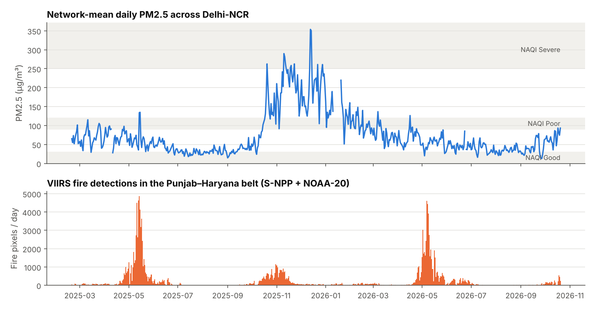
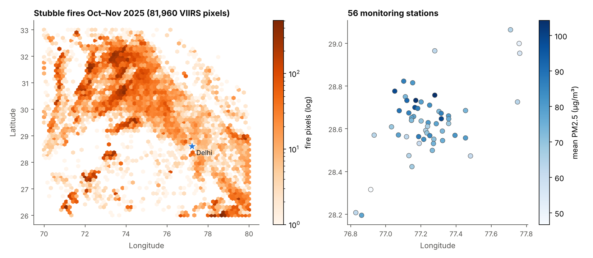

# Delhi-NCR PM2.5 forecasting — 24 to 72 hours ahead

[](https://delhi-aqi-forecast-ml.streamlit.app/)
[](https://github.com/akhilnathreddy/delhi-aqi-forecast/actions/workflows/ci.yml)


**Try it:** [delhi-aqi-forecast-ml.streamlit.app](https://delhi-aqi-forecast-ml.streamlit.app/) gives a live 72-hour forecast for every station, plus a backtest explorer.

Multi-source, multi-horizon forecasts of hourly PM2.5 for **56 regulatory monitoring stations** across Delhi, Gurugram, Noida, Ghaziabad, Faridabad and the wider NCR. The models fuse three real, public data streams:

| Source | What | How it is fetched |
|---|---|---|
| **CPCB / DPCC / HSPCB / UPPCB / IMD / IITM stations** | 15-min PM2.5, PM10, NO₂, CO, O₃ | OpenAQ's public AWS archive (`openaq-data-archive`), one gzipped CSV per station-day, reduced to QC'd hourly values |
| **NOAA GFS 1° forecasts** | 2 m temperature & RH, 10 m and 850 hPa winds, boundary-layer height, rain, cloud, 850 hPa temperature | `noaa-gfs-bdp-pds`, **byte-range requests** on the GRIB2 `.idx` sidecar (~0.7 MB per lead instead of 45 MB) |
| **VIIRS 375 m active fires** (stubble burning) | fire pixels with FRP over Punjab, Haryana, Pakistani Punjab, W-UP | NOAA's Enterprise Active Fire EDR on `noaa-nesdis-{snpp,n20}-pds`, the same I-band algorithm family that NASA FIRMS serves. Granules are pre-screened by reading only their 24 kB netCDF header footprint. A FIRMS-API downloader with the same schema is included for people with a `MAP_KEY` |

Period: **2025-02-19 → 2026-10-20**. That's 14,616 hours, 82% of station-hours observed, 613 GFS cycles and 562k fire pixels (154k in the Punjab–Haryana paddy belt).



## What's interesting here

**1. Honest forecasting setup.** At each forecast origin the models only see what a forecaster would actually have:
- the *GFS forecast* from the newest 00Z cycle published by then (5 h latency), never observed future weather;
- fire detections only after a 3 h publication latency;
- targets that are later masked wherever a station was offline.

**2. Smoke-arrival index (SAI), a physics-informed known-future covariate.** Every fire pixel is advected towards Delhi with the 850 hPa source-region wind at detection time. Fires whose wind doesn't point at Delhi contribute nothing. The rest "arrive" after `distance / along-track wind` hours, smeared by a Gaussian that widens with travel time. Because SAI(t+h) depends only on fires already detected at t, it's a legitimate *future* input: smoke already on its way (`src/aqf/features.py`).

**3. Models**, all with 10/50/90 % quantile outputs:

| Model | Idea |
|---|---|
| Persistence, diurnal persistence, climatology | references every model must beat |
| **LightGBM** (direct multi-horizon) | one booster per quantile, lead time as a feature, ~67 engineered features |
| **Temporal Fusion Transformer** | written from scratch in PyTorch (`src/aqf/models/tft.py`): GRNs, static-conditioned variable selection, LSTM seq2seq, static enrichment, interpretable multi-head attention, monotone quantile head |
| **Wind-aware spatio-temporal GNN** | (`src/aqf/models/stgnn.py`) shared GRU encoder per station, diffusion graph convolutions over three supports (distance kernel, learned adaptive adjacency, and a wind-advection adjacency rebuilt each hour from the forecast wind, so pollution propagates downwind), GRU decoder over the known-future inputs |
| Ensemble | mean of LightGBM, TFT and GNN quantiles in log space |
| **Level-anchored variants** (`*_anchored`, `lightgbm_resid`) | same models, but each predicts the change in log-PM2.5 from the last-6-h mean instead of the level. Learned models can't extrapolate above the targets they were trained on; anchoring lets them follow an unprecedented episode |

**4. Evaluation that matches how AQI is used.** Results cover:
- hourly MAE/RMSE at every lead;
- 24-h-mean errors for days 1–3;
- India **NAQI category accuracy**;
- hit and false-alarm rates for "Very Poor" (>120 µg/m³) days;
- pinball loss and 80 % interval coverage;
- **skill vs persistence**.

Two blocked folds are used:
- **`main`**, forward in time: train Feb 2025–Mar 2026, validate Apr–Jun 2026, test Jul–Oct 2026, which includes the start of the 2026 stubble season.
- **`winter`**, held-out season: test on Oct–Dec 2025, the stubble-burning and early-winter peak.

Each partition boundary has a 72 h embargo, so no target hour is shared between train and test.

## Results

### Headline numbers (56 stations, 72 h forecasts issued every 6 h)

| Test period | Persistence MAE | Best model | Best MAE | Skill (hourly MAE) | Day-1 NAQI category accuracy |
|---|---|---|---|---|---|
| **`main`**: Jul–Oct 2026 (monsoon → post-monsoon) | 22.6 µg/m³ | Ensemble (LGBM + TFT + GNN) | **16.3** | **−28 %** | 56 % → **66 %** |
| **`winter`**: Oct–Dec 2025 (stubble season + winter peak, held-out season) | 80.8 µg/m³ | Ensemble, level-anchored | **60.2** | **−25 %** | 54 % → **60 %** |

<details><summary>Per-model table, <code>main</code> fold</summary>

| Model | MAE | @24 h | @48 h | @72 h | Day-1 mean MAE | Skill vs persistence (day 1/2/3) | 80 % PI coverage |
|---|---|---|---|---|---|---|---|
| Persistence | 22.6 | 19.2 | 22.0 | 24.0 | 15.1 | — | — |
| Diurnal persistence | 22.0 | 18.9 | 21.7 | 23.7 | 11.7 | +23 / +21 / +20 % | — |
| Climatology | 21.6 | 23.5 | 23.4 | 23.5 | 17.2 | −14 / +13 / +21 % | — |
| LightGBM | 17.2 | 16.1 | 17.2 | 18.0 | 10.8 | +28 / +35 / +35 % | 72 % |
| Temporal Fusion Transformer | 16.7 | 16.6 | 17.1 | 17.9 | 10.1 | +33 / +39 / +42 % | 68 % |
| Wind-aware ST-GNN | 16.7 | 16.4 | 16.8 | 17.6 | 10.7 | +29 / +35 / +37 % | 71 % |
| **Ensemble** | **16.3** | **15.9** | **16.4** | **17.0** | **10.1** | +33 / +39 / +41 % | 73 % |
| Ensemble (level-anchored) | 16.7 | 16.0 | 17.0 | 17.7 | 10.4 | +31 / +35 / +36 % | 69 % |
</details>

<details><summary>Per-model table, <code>winter</code> fold</summary>

| Model | MAE | @24 h | @48 h | @72 h | Day-1 mean MAE | Skill vs persistence (day 1/2/3) | Mean bias |
|---|---|---|---|---|---|---|---|
| Persistence | 80.8 | 54.6 | 65.8 | 72.1 | 53.5 | — | −3.5 |
| Diurnal persistence | 67.5 | 53.1 | 65.1 | 71.0 | **38.7** | +28 / +23 / +23 % | −3.1 |
| LightGBM | 71.8 | 63.6 | 65.6 | 66.7 | 61.2 | −14 / +5 / +10 % | −62.5 |
| Temporal Fusion Transformer | 71.2 | 66.5 | 68.5 | 68.2 | 56.4 | −5 / +3 / +9 % | −60.7 |
| Wind-aware ST-GNN | 93.6 | 86.0 | 84.1 | 84.4 | 84.2 | −57 / −35 / −24 % | −89.1 |
| LightGBM (level-anchored) | 65.6 | 56.4 | 61.5 | 63.3 | 51.6 | +4 / +15 / +18 % | −52.7 |
| TFT (level-anchored) | 62.2 | 54.5 | 58.4 | 62.2 | 45.9 | +14 / +23 / +25 % | −42.3 |
| ST-GNN (level-anchored) | 61.9 | 52.8 | 60.0 | 67.9 | 39.3 | +27 / +24 / +24 % | −23.9 |
| **Ensemble (level-anchored)** | **60.2** | **51.9** | **56.0** | **57.9** | 44.2 | +17 / +24 / **+27 %** | −41.4 |
</details>


### What the experiments show

1. **Forecast weather is the most valuable input.** Replacing the GFS forecast with history only costs +1.1 µg/m³ MAE in `main` and **+9.4 µg/m³ in `winter`**. The TFT's decoder puts its largest selection weights on forecast ventilation, 10 m wind, cloud, the 850 hPa–2 m inversion and boundary-layer height, which is the meteorology of Delhi's winter trapping.
2. **Fire impact depends on the season, and the models only partly learn that.** Daily network PM2.5 correlates with the smoke-arrival index at **r = +0.56 in Oct–Nov 2025** but **r ≈ +0.05 in Apr–May**, even though April–May wheat-residue burning produces more than twice as many fire pixels per day. In summer the 2–4 km afternoon mixing layer dilutes the smoke. With only one observed paddy season available, removing the fire inputs is neutral to slightly *better* overall (64.4 vs 65.6 in `winter`), with a small gain at 24 h (56.4 vs 57.6). An honest negative result: the SAI is physically informative, but the models need more burning seasons, or an explicit SAI × mixing-height interaction, to use it.
3. **Holding out the peak season exposes level extrapolation.** Models that predict the PM2.5 *level* underpredict Nov–Dec 2025 by 60–90 µg/m³ on average, because nothing like it was in their training targets. **Predicting the change from the current level** fixes most of it. The ST-GNN goes from 93.6 to 61.9 MAE and its bias from −89 to −24. The cost in `main` is negligible (16.3 to 16.7).
4. **Uncertainty is too narrow in the hardest regime.** The nominal 80 % intervals cover 68–73 % of hours in `main` but only 64–66 % in `winter` (level-anchored models). Conformal recalibration per season is the obvious next step.
5. **Simple baselines are hard to beat in the peak season.** In `winter`, diurnal persistence still has the best day-1 *daily-mean* error (38.7, against 39.3 for the anchored ST-GNN). The learned models win on hourly error and on days 2–3. All models underpredict the most extreme 600–700 µg/m³ hourly spikes; the example below shows one.




Full tables and every figure: [`reports/RESULTS.md`](reports/RESULTS.md). The development log, with every problem hit along the way, how it was fixed, and the training and early-stopping details: [`docs/DEVLOG.md`](docs/DEVLOG.md).

## Web app

`streamlit_app.py` turns the project into a tool anyone can open:

- **Live forecast.** One click fetches the latest CPCB station data, the newest GFS run and VIIRS fires (about 1–2 minutes; cached for 3 hours). It then runs the level-anchored ensemble trained on all data (`models/final/`) and shows the next 72 hours: a station map coloured by NAQI category, day 1–3 means for every station, the weather and smoke drivers, per-station fan charts and a CSV download.
- **Backtest explorer.** Pick a station and any forecast from the two held-out test periods, and see what the models predicted against what actually happened. This uses the bundled `app/backtest.npz`, so it works without any downloads.

The public OpenAQ archive lags real time by 2–4 days. When the newest observations are older than a few hours, the app rolls the model forward across the gap, issues the forecast from the current hour, and labels the filled stretch on every chart. With a free [OpenAQ API key](https://explore.openaq.org/register) it tops up the last days of PM2.5 from the OpenAQ v3 API instead. That code path follows the v3 docs but couldn't be exercised from the build environment, so check it once after you add the key.

**Run locally**

```bash
pip install -r requirements.txt
streamlit run streamlit_app.py
```

**Deploy on Streamlit Community Cloud (free)**

1. Go to [share.streamlit.io](https://share.streamlit.io), sign in with GitHub and click **Create app**.
2. Choose this repository, branch `main`, main file `streamlit_app.py`.
3. Optional: under **Advanced settings → Secrets**, add `OPENAQ_API_KEY = "your-key"` for near-real-time station data.
4. Deploy. The first build installs CPU PyTorch and takes a few minutes.

To refresh the served models after new data arrives: `make data build`, then `python -m aqf.cli train-final` and `python -m aqf.cli export-app`.

## Reproduce

```bash
pip install -e ".[download,dev]"          # eccodes + netCDF4 are only needed for downloading
make data      # ~1 h: stations, GFS (byte-range), VIIRS fires — all public, no keys
make build     # align everything into data/processed/dataset.npz
make train     # both folds, all 14 models (~6 h on 4 CPU cores; much faster on a Colab GPU)
make report    # figures + reports/RESULTS.md
make test      # unit tests: parsers, transport physics, leakage, model causality
```

Or open [`notebooks/colab_full_pipeline.ipynb`](notebooks/colab_full_pipeline.ipynb) in Google Colab with a GPU runtime and *Run all*.

`configs/stations.csv` holds the station list. It came from a scan of all 56k locations in the OpenAQ archive (`aqf discover-stations`), filtered to regulatory networks inside the NCR box. Low-cost sensors are excluded.

## Layout

```
src/aqf/
  data/        http.py · openaq.py · openaq_api.py · gfs.py · fires.py      raw-data downloaders
  features.py  weather derivatives, fire transport, SAI, calendar (Diwali)
  dataset.py   hourly alignment, blocked folds, past/future/target tensors
  models/      baselines.py (persistence, climatology, LightGBM) · tft.py · stgnn.py
  train.py     quantile loss, early-stopped training, TFT interpretation
  metrics.py   point / daily NAQI / probabilistic scores
  experiment.py, report.py, cli.py
  serve.py     train/save/load the serving bundle in models/final
  live.py      issue a forecast now (fetch → build → predict, gap-filling stale observations)
streamlit_app.py   the web app · app/backtest.npz its bundled backtest data
tests/         22 unit tests (no network)
```

## Limitations and next steps

- **Order of experiments, stated plainly:** the level-anchored variants were added *after* seeing the original models fail on the `winter` fold. They're reported next to the originals, not instead of them, and they were run unchanged on `main`. With only two folds, treat their margin as indicative, not tuned-and-confirmed.
- About 20 months of data. Only one full stubble season (2025) is fully observed; the 2026 season is still unfolding in the `main` test window.
- GFS 1° is coarse for intra-city gradients. ERA5 or IMD WRF at 3 km would sharpen the meteorology. ERA5 is on the public `gcp-public-data-arco-era5` bucket but is global-chunked and too heavy to pull here.
- Trajectories are a straight-line advection proxy. A HYSPLIT or FLEXPART back-trajectory feature would be the principled upgrade.
- Next model steps: an SAI × mixing-height interaction feature, per-season conformal interval calibration, aerosol optical depth (VIIRS JRR-AOD is on the same NOAA bucket) and GRAP-stage policy flags as covariates.
- Past weather comes from GFS analyses and short-range forecasts, standing in for real-time surface observations. For the last few hours before an origin, those analyses wouldn't be published yet.

Data © CPCB/State PCBs via OpenAQ (CC BY 4.0), NOAA (public domain). Code MIT.
