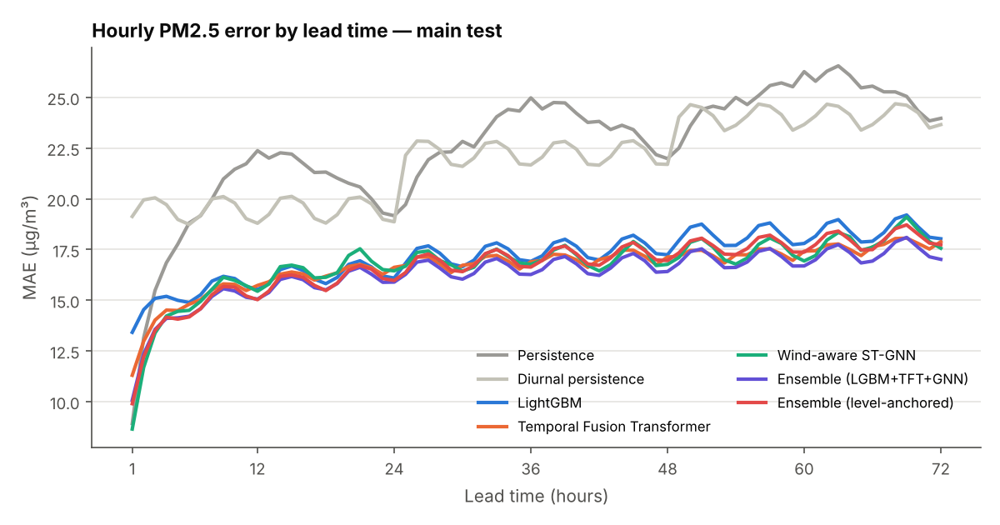
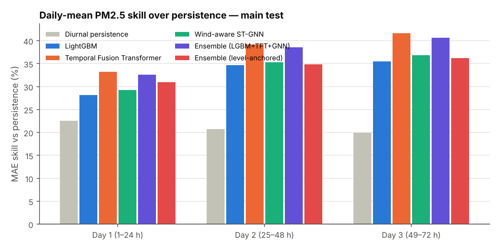
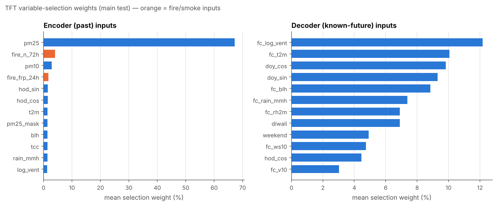
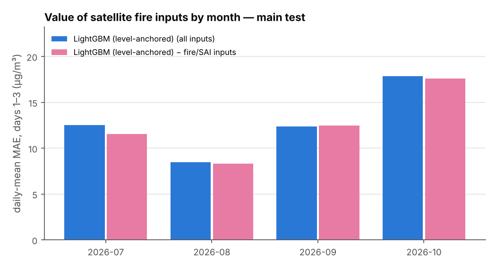
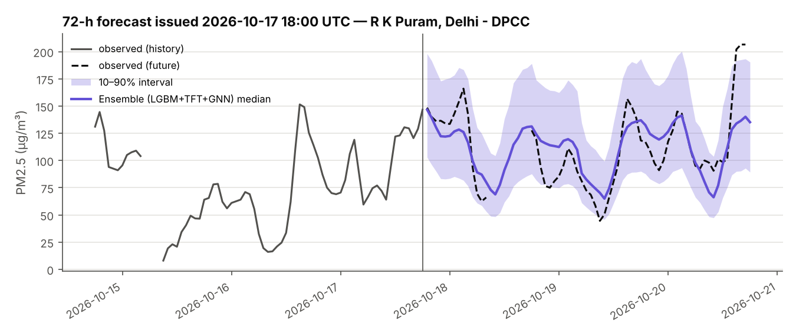
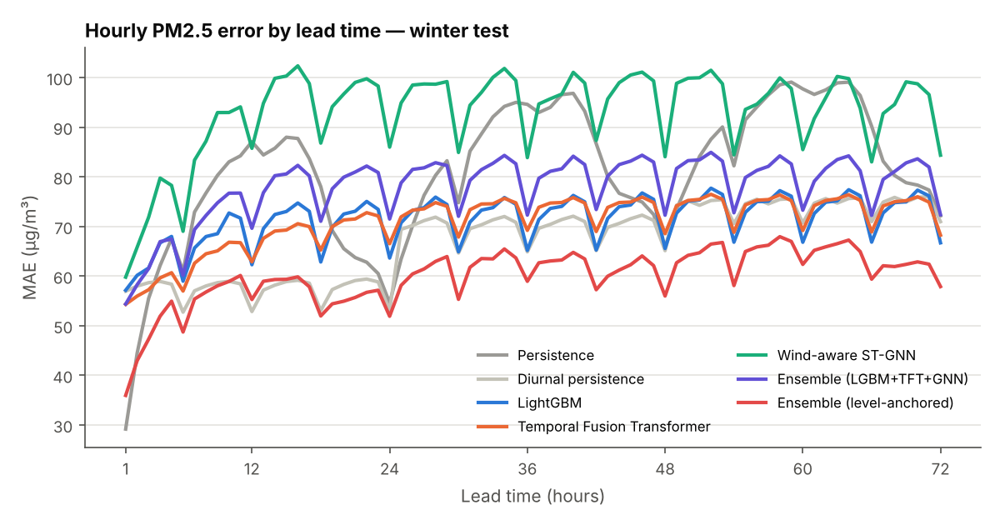
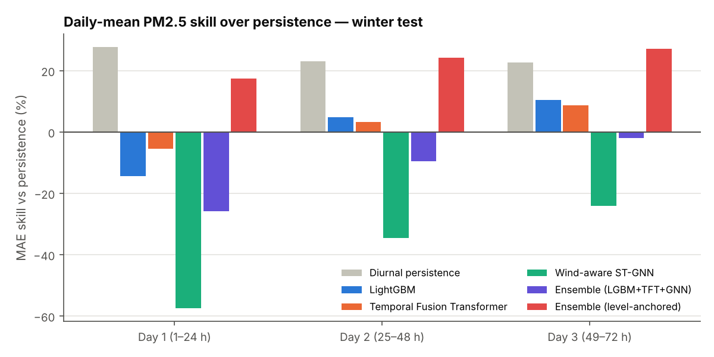
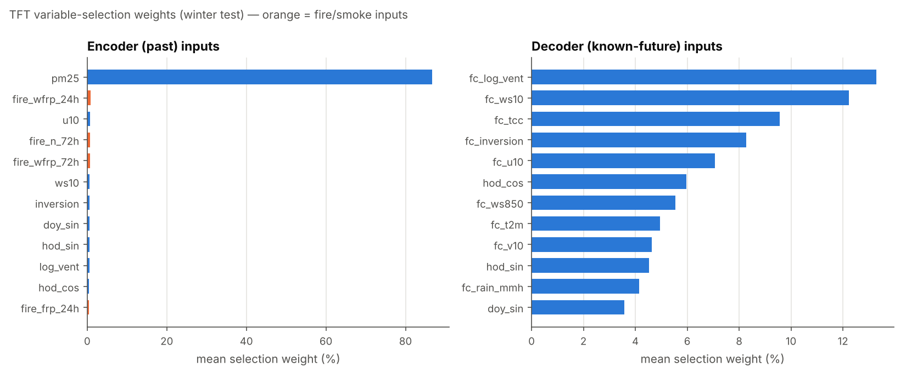
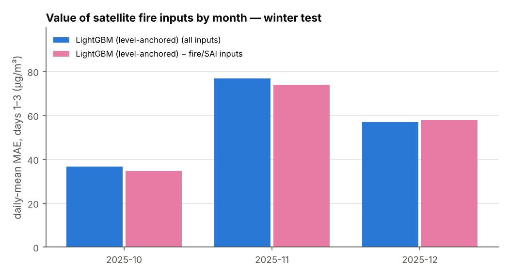
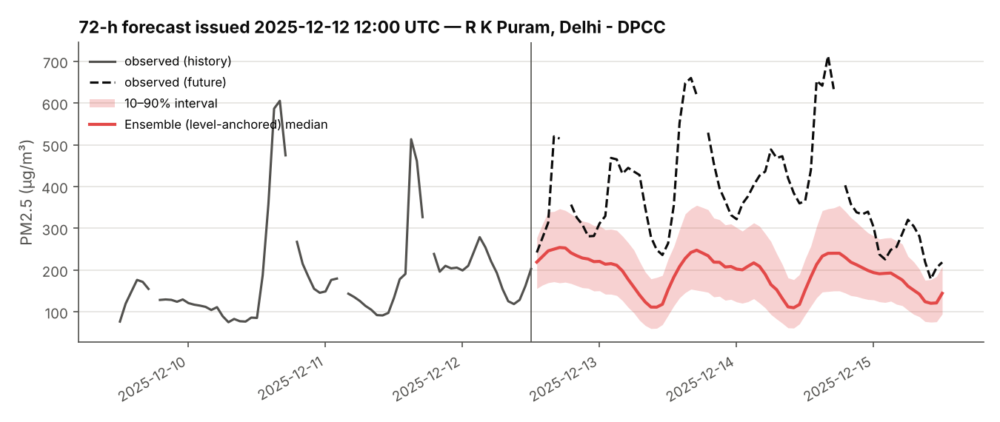

# Results

All numbers are on held-out test periods, in µg/m³ of hourly PM2.5 unless noted. Generated by `aqf report`.

## When do fires matter? (daily correlations, whole network)

| Season | belt fire pixels/day | corr(PM2.5, SAI) | corr(PM2.5, fires 24 h) | corr(PM2.5, BLH) |
|---|---|---|---|---|
| Wheat residue, Apr–May 2025 | 918 | +0.07 | -0.07 | +0.21 |
| Paddy stubble, Oct–Nov 2025 | 389 | +0.56 | +0.52 | -0.58 |
| Wheat residue, Apr–May 2026 | 807 | +0.03 | -0.04 | +0.48 |
| Paddy stubble, Oct 2026 (so far) | 177 | +0.32 | +0.71 | -0.52 |

## Fold `main`

Train [['2025-02-19', '2026-03-31']] · validation [['2026-04-01', '2026-06-30']] · **test [['2026-07-01', '2026-10-20']]** — 56 stations, 424 forecast origins (every 6 h), 83% of target hours observed.

| Model | MAE all leads | RMSE | MAE @24h | @48h | @72h | Day-1 mean MAE | Day-1 NAQI cat. acc. | Skill vs persistence (day 1 / 2 / 3) | 80% PI coverage |
|---|---|---|---|---|---|---|---|---|---|
| Persistence | 22.6 | 34.5 | 19.2 | 22.0 | 24.0 | 15.1 | 56% | +0% / +0% / +0% | — |
| Diurnal persistence | 22.0 | 32.7 | 18.9 | 21.7 | 23.7 | 11.7 | 63% | +23% / +21% / +20% | — |
| Climatology | 21.6 | 31.1 | 23.5 | 23.4 | 23.5 | 17.2 | 44% | -14% / +13% / +21% | — |
| LightGBM | 17.2 | 25.9 | 16.1 | 17.2 | 18.0 | 10.8 | 63% | +28% / +35% / +35% | 72% |
| LightGBM − fire features | 17.0 | 25.8 | 15.9 | 17.2 | 18.0 | 10.5 | 64% | +30% / +36% / +36% | 72% |
| LightGBM − GFS forecast | 18.3 | 27.1 | 17.2 | 18.5 | 19.1 | 12.3 | 58% | +18% / +26% / +29% | 74% |
| Temporal Fusion Transformer | 16.7 | 25.0 | 16.6 | 17.1 | 17.9 | 10.1 | 66% | +33% / +39% / +42% | 68% |
| Wind-aware ST-GNN | 16.7 | 25.9 | 16.4 | 16.8 | 17.6 | 10.7 | 65% | +29% / +35% / +37% | 71% |
| Ensemble (LGBM+TFT+GNN) | 16.3 | 25.0 | 15.9 | 16.4 | 17.0 | 10.1 | 66% | +33% / +39% / +41% | 73% |
| LightGBM (level-anchored) | 17.1 | 25.8 | 16.1 | 17.3 | 18.0 | 10.6 | 63% | +30% / +35% / +36% | 69% |
| LightGBM (level-anchored) − fire | 16.8 | 25.6 | 15.8 | 17.1 | 18.0 | 10.1 | 65% | +33% / +37% / +36% | 69% |
| TFT (level-anchored) | 17.1 | 26.1 | 16.6 | 17.5 | 18.3 | 10.7 | 64% | +29% / +31% / +33% | 67% |
| ST-GNN (level-anchored) | 16.9 | 25.8 | 16.2 | 17.1 | 18.1 | 10.5 | 65% | +30% / +35% / +36% | 67% |
| Ensemble (level-anchored) | 16.7 | 25.6 | 16.0 | 17.0 | 17.7 | 10.4 | 65% | +31% / +35% / +36% | 69% |

## Fold `winter`

Train [['2025-02-19', '2025-08-09'], ['2026-01-01', '2026-10-20']] · validation [['2025-08-10', '2025-09-30']] · **test [['2025-10-01', '2025-12-31']]** — 56 stations, 344 forecast origins (every 6 h), 87% of target hours observed.

| Model | MAE all leads | RMSE | MAE @24h | @48h | @72h | Day-1 mean MAE | Day-1 NAQI cat. acc. | Skill vs persistence (day 1 / 2 / 3) | 80% PI coverage |
|---|---|---|---|---|---|---|---|---|---|
| Persistence | 80.8 | 116.4 | 54.6 | 65.8 | 72.1 | 53.5 | 54% | +0% / +0% / +0% | — |
| Diurnal persistence | 67.5 | 100.3 | 53.1 | 65.1 | 71.0 | 38.7 | 65% | +28% / +23% / +23% | — |
| Climatology | 126.7 | 163.7 | 115.1 | 116.9 | 118.5 | 122.8 | 6% | -130% / -81% / -71% | — |
| LightGBM | 71.8 | 108.3 | 63.6 | 65.6 | 66.7 | 61.2 | 47% | -14% / +5% / +10% | 48% |
| LightGBM − fire features | 67.1 | 102.4 | 60.0 | 62.6 | 64.5 | 55.8 | 52% | -4% / +13% / +16% | 51% |
| LightGBM − GFS forecast | 81.2 | 119.0 | 70.5 | 73.8 | 75.0 | 69.6 | 36% | -30% / -11% / -5% | 42% |
| Temporal Fusion Transformer | 71.2 | 108.0 | 66.5 | 68.5 | 68.2 | 56.4 | 52% | -5% / +3% / +9% | 52% |
| Wind-aware ST-GNN | 93.6 | 130.9 | 86.0 | 84.1 | 84.4 | 84.2 | 21% | -57% / -35% / -24% | 36% |
| Ensemble (LGBM+TFT+GNN) | 78.3 | 115.8 | 71.5 | 72.3 | 72.4 | 67.3 | 40% | -26% / -10% / -2% | 46% |
| LightGBM (level-anchored) | 65.6 | 99.5 | 56.4 | 61.5 | 63.3 | 51.6 | 52% | +4% / +15% / +18% | 60% |
| LightGBM (level-anchored) − fire | 64.4 | 97.8 | 57.6 | 61.7 | 63.5 | 50.0 | 54% | +7% / +16% / +19% | 60% |
| TFT (level-anchored) | 62.2 | 95.1 | 54.5 | 58.4 | 62.2 | 45.9 | 59% | +14% / +23% / +25% | 64% |
| ST-GNN (level-anchored) | 61.9 | 92.3 | 52.8 | 60.0 | 67.9 | 39.3 | 62% | +27% / +24% / +24% | 66% |
| Ensemble (level-anchored) | 60.2 | 92.5 | 51.9 | 56.0 | 57.9 | 44.2 | 60% | +17% / +24% / +27% | 66% |

